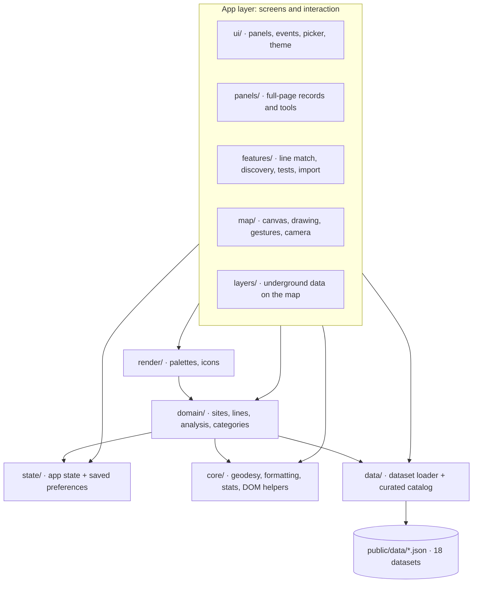
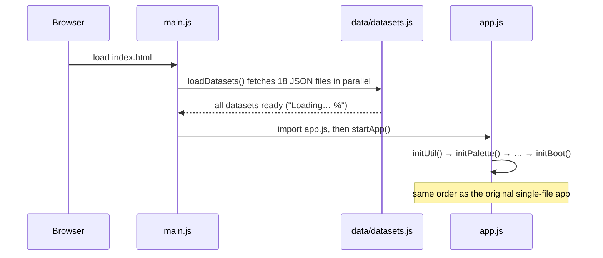

# Ley Atlas architecture

Ley Atlas is a static web app: plain JavaScript (ES modules), HTML canvas for the map, d3 for projections, and no server. Vite builds it; GitHub Actions tests it and publishes it to GitHub Pages.

## The big picture

**The rule:** arrows only point down. `core`, `data`, `state`, `domain` and `render` never import from the app layer. Lint and review keep it that way. Inside the app layer, modules still call each other freely (see _Known debts_).

## Folders

| Folder      | What lives here                                                                                                             | Imports from                   |
| ----------- | --------------------------------------------------------------------------------------------------------------------------- | ------------------------------ |
| `core/`     | Pure helpers: great-circle maths (`geo.js`), number/coordinate formatting, statistics, tiny DOM helpers                     | nothing above it               |
| `data/`     | `datasets.js` loads the 18 JSON files; `catalog.js` is the hand-curated project sites and alignments                        | `core`                         |
| `state/`    | `S` (map, lines, layers, selection) and `V2` (2.x preferences), with localStorage persistence                               | `core`, `data`                 |
| `domain/`   | Builds the site list from all datasets, the lines, which sites sit on which line, display categories                        | `core`, `data`, `state`        |
| `render/`   | Colour palettes, line styles, SVG icons                                                                                     | `domain`, `state`              |
| `map/`      | Canvas, projection, drawing loop, tiles, gestures, camera, overlays, zoomed-out modes                                       | anything below, plus app layer |
| `layers/`   | Underground layers: deposits, faults, plates, magnetic grids                                                                | anything below, plus app layer |
| `features/` | Line match, discovery along a line, creating lines, "Is it unusual?", underground test, CSV/GeoJSON import, follow-the-line | anything below, plus app layer |
| `ui/`       | Panels (Explore / Draw / Analyze / Menu / Saved), event wiring, picker, sheet, theme, swipe-to-delete                       | anything below, plus app layer |
| `panels/`   | Full-page tools opened from the menu: layers, record detail, data, lines, forts                                             | anything below, plus app layer |

## How it starts

- Modules do **no work when imported**: at module level there are only functions and constant literals. Anything that needs data, the DOM or another module runs inside the module's `initX()` function.
- `app.js` calls every `initX()` in a fixed order. That order matters (for example, points must exist before lines are built), so keep new init calls in a sensible place in that list.
- Because importing is side-effect free, any module can be loaded in a unit test without a browser.

## Shared variables and setters

Modules export the variables other modules read (`export let W, H`). ES modules make these _live_: readers always see the current value. Only the owning module may assign them. When another module must change one, the owner exports a setter, e.g. `setBC(null)` in `map/draw.js`. Eleven such setters exist; prefer adding a function with a clear name over adding more setters.

## How to…

**Add a dataset**

1. Put the JSON file in `public/data/`.
2. Add it to `FILES` and the `export let` list in `src/data/datasets.js`.
3. Use it from `domain/` (to turn records into sites) or `layers/` (to draw it on the map).
4. Add a check to `tests/data.test.js`.

**Add a feature**

1. Create `src/features/<name>.js`. Put pure maths in `src/core/` with tests.
2. If it needs set-up, export `initName()` and call it from `src/app.js`.
3. Add its button or panel in `src/ui/panels.js`, and handle the action in `v2HandleAction` (`ui/panels.js`) or `ui/events.js`.
4. Add styles as a new file in `src/styles/` and `@import` it at the end of `src/styles/index.css`.

**Remove a feature:** delete its module, then run `npm run lint`. Every place that still uses it shows up as an error (`no-undef`). Remove those, and lint again until it is clean.

## Quality gates

| Command                | What it checks                                         |
| ---------------------- | ------------------------------------------------------ |
| `npm run lint`         | ESLint: undefined names (missing imports), unused code |
| `npm run format:check` | Prettier formatting                                    |
| `npm test`             | Vitest unit tests (`tests/`)                           |
| `npm run build`        | Production build into `dist/`                          |
| `npm run check`        | All of the above; CI runs the same on every push       |

## Known debts (next refactors, in order)

1. **App-layer cycles.** `map`, `ui`, `features`, `panels` and `layers` import each other. Next step: a small event bus (`lineChanged`, `selectionChanged`, `layersChanged`) so features subscribe instead of being called directly by the drawing loop and panels.
2. **Feature registry.** With the bus in place, each feature exports `{ id, init, draw?, panel? }` and `app.js` lists features in one array: removing a feature becomes deleting one line.
3. **Big files.** `ui/panels.js` (≈900 lines) and `map/draw.js` (≈830) should be split by screen and by layer.
4. **Legacy panes.** Some 2.x screens (Layers, Is it unusual?, Data) still render into the 1.x panes (`#p-layers`, `#p-lab`, `#p-data`). Port them to the 2.x panel renderer.
5. **Lazy datasets.** The magnetic grid, deposits and detailed basemap (≈4.3 MB gzipped) load up front. Load them when their layer is first switched on.

## How this structure was made

Version 2.1 was a single 11 MB HTML file. In November 2026 it was split by an automated, scope-aware transform: every top-level name was traced to its declaring section, and imports, exports and setters were generated from that. Code was then formatted and dead code (28 unreferenced functions and constants from the 1.x/2.0 interfaces) removed.

Parity was checked in headless Chrome against the original file: pixel-identical map on phone and desktop, identical text and screenshots through the draw-a-line and line-match flow, and an identical, error-free click-through of every menu section. The original single file is in git history at commit `eba7dc4`.
