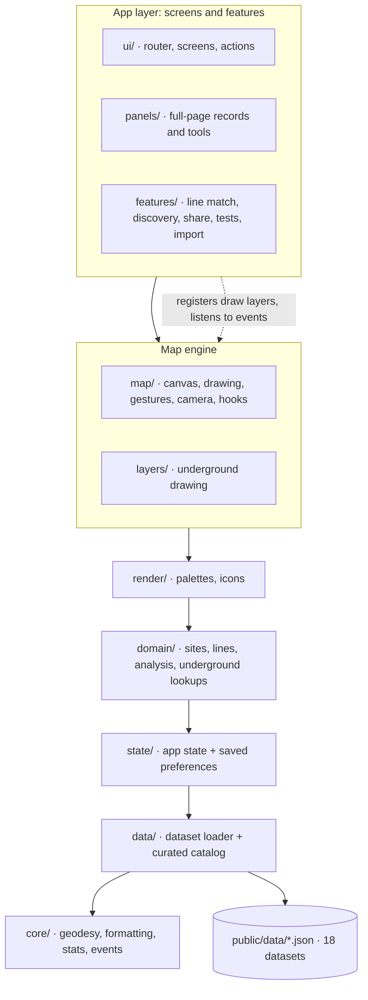
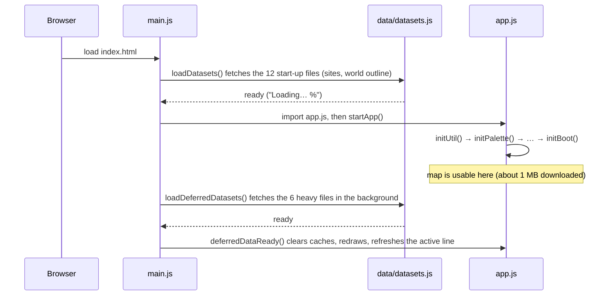

# Ley Atlas architecture

Ley Atlas is a static web app: plain JavaScript (ES modules), HTML canvas for the map, d3 for projections, and no server. Vite builds it; GitHub Actions tests it and publishes it to GitHub Pages.

## The big picture

**The rule:** arrows only point down. `core`, `data`, `state`, `domain`, `render`, `map` and `layers` never import from `features`, `ui` or `panels`. ESLint enforces this (`no-restricted-imports` in `eslint.config.js`), so a wrong import fails `npm run lint` and CI. When a lower layer needs to tell an upper one something, it uses an event or a hook (below).

## Folders

| Folder      | What lives here                                                                                                                                   | May import from      |
| ----------- | ------------------------------------------------------------------------------------------------------------------------------------------------- | -------------------- |
| `core/`     | Pure helpers: great-circle maths, formatting, statistics, share-link encoding, polyline decoding, the event bus, tiny DOM helpers                 | nothing              |
| `data/`     | `datasets.js` loads the JSON files; `catalog.js` is the hand-curated project sites and alignments                                                 | `core`               |
| `state/`    | `S` (map, lines, layers, selection) and `V2` (2.x preferences), with localStorage persistence                                                     | `core`, `data`       |
| `domain/`   | Sites from all datasets, lines, which sites sit on which line, display categories, underground lookups (deposits, faults, plates, magnetic grids) | the above            |
| `render/`   | Colour palettes, line styles, SVG icons                                                                                                           | the above            |
| `map/`      | Canvas, projection, drawing loop, base layer, tiles, gestures, camera, zoomed-out modes, and the map's extension points (`hooks.js`)              | the above + `layers` |
| `layers/`   | Draws the underground layers on the map                                                                                                           | the above + `map`    |
| `features/` | Line match, discovery, creating and dragging lines, line overlay, share links, "Is it unusual?", underground test, import, follow-the-line        | anything             |
| `ui/`       | Panel router, screens (`ui/screens/`), actions, registries, picker, sheet, theme, map taps, downloads                                             | anything             |
| `panels/`   | Full-page tools: layers, site record, deposit and fault records, data, lines                                                                      | anything             |

## How features plug in

A feature never edits the drawing loop or the panel router. In its `initX()` it registers what it needs:

| Extension point                    | Where            | Use it to                                               |
| ---------------------------------- | ---------------- | ------------------------------------------------------- |
| `on(event, fn)` / `emit(event, …)` | `core/events.js` | React to something a lower layer announces              |
| `addDrawLayer(stage, fn)`          | `map/hooks.js`   | Draw on the map at `beforeLines`, `underLines` or `top` |
| `addSiteHighlighter(fn)`           | `map/hooks.js`   | Name sites that must always be drawn in full and ringed |
| `registerScreen(id, render)`       | `ui/registry.js` | Add a panel screen (shown when `V2.tab === id`)         |
| `registerAction(name, fn)`         | `ui/registry.js` | Say what `<button data-v2="name">` does                 |

Events in use:

| Event               | Sent by              | Arguments              | Who listens                                 |
| ------------------- | -------------------- | ---------------------- | ------------------------------------------- |
| `map:tap`           | `map/interaction.js` | `x, y` (canvas pixels) | `ui/map-taps.js`                            |
| `map:gesture-start` | `map/interaction.js` | none                   | intro (ends it), follow-the-line (stops it) |
| `map:wheel`         | `map/interaction.js` | none                   | intro                                       |
| `tiles:blocked`     | `map/tiles.js`       | none                   | `ui/sheet.js` (message, re-render)          |

`features/share-link.js` is the model to copy: one file, one `initShareLink()` that registers its action, pure logic in `core/share.js` with tests.

## How it starts

**Two-phase data.** The deferred datasets (detailed coastline, deposits, faults, plates, both magnetic grids) start as empty placeholders of the right shape, so code that reads them never crashes; it just finds nothing until they arrive. Anything that caches a result derived from them must be reset in `deferredDataReady()` in `src/app.js`. Work that must not run on empty data (line match) waits with `whenDeferredLoaded()`.

**Offline / install.** `vite-plugin-pwa` generates a service worker that precaches the app and all datasets, plus a web manifest (`vite.config.js`). Icons are in `public/icons/`.

**Share links.** `core/share.js` encodes and decodes the address (`?a=…&b=…`, `?p=…`, `?l=…`, `?c=…`); `features/share-link.js` builds one from the current state and applies one at start-up.

- Modules do **no work when imported**: at module level there are only functions and constant literals. Anything that needs data, the DOM or another module runs inside the module's `initX()` function.
- `app.js` calls every `initX()` in a fixed order. That order matters (for example, points must exist before lines are built), so keep new init calls in a sensible place in that list.
- Because importing is side-effect free, any module can be loaded in a unit test without a browser.

## Shared variables and setters

Modules export the variables other modules read (`export let W, H`). ES modules make these _live_: readers always see the current value. Only the owning module may assign them. When another module must change one, the owner exports a setter, e.g. `setBC(null)` in `map/draw.js`. Eleven such setters exist; prefer adding a function with a clear name over adding more setters.

## How to…

**Add a dataset**

1. Put the JSON file in `public/data/`.
2. Add it to `FILES` and the `export let` list in `src/data/datasets.js`.
3. Use it from `domain/` (to turn records into sites) or `layers/` (to draw it on the map).
4. Add a check to `tests/data.test.js`.

**Add a feature**

1. Create `src/features/<name>.js`. Put pure maths in `src/core/` with tests.
2. Export `initName()` and call it from `src/app.js`. In it, register what the feature needs: actions, a screen, draw layers, event handlers (see _How features plug in_).
3. Put its button in the screen that should show it (`src/ui/screens/`), as `v2Button('your-action', 'Label')`.
4. Add styles as a new file in `src/styles/` and `@import` it at the end of `src/styles/index.css`.

**Remove a feature:** delete its module, then run `npm run lint`. Every place that still uses it shows up as an error (`no-undef`). Remove those, and lint again until it is clean.

## Quality gates

| Command                | What it checks                                         |
| ---------------------- | ------------------------------------------------------ |
| `npm run lint`         | ESLint: undefined names (missing imports), unused code |
| `npm run format:check` | Prettier formatting                                    |
| `npm test`             | Vitest unit tests (`tests/`)                           |
| `npm run build`        | Production build into `dist/`                          |
| `npm run check`        | All of the above; CI runs the same on every push       |

## Known debts (next refactors, in order)

1. **App-layer cycles.** `features`, `ui` and `panels` still import each other (47 import cycles, down from 93). Most run through `changed()` in `ui/sheet.js` and `v2Render()`. Next: turn those into `state:changed` / `line:changed` events.
2. **Action switch.** `ui/actions.js` is still one 250-line `switch`. Only Share uses `registerAction` so far. Move each feature's cases into its own module as that feature is next touched.
3. **`map/draw.js`** is still 480 lines with one long `draw()` that draws lines and sites inline. It is due to be replaced by the map-engine change (MapLibre), so it has not been split further.
4. **Legacy panes.** Some 2.x screens (Layers, Is it unusual?, Data) still render into the 1.x panes (`#p-layers`, `#p-lab`, `#p-data`). Port them to `registerScreen`.
5. **Deferred data resets** are explicit calls in `deferredDataReady()` (`src/app.js`). Make it a `data:loaded` event that each module handles itself.

## How this structure was made

Version 2.1 was a single 11 MB HTML file. In November 2026 it was split by an automated, scope-aware transform: every top-level name was traced to its declaring section, and imports, exports and setters were generated from that. Code was then formatted and dead code (28 unreferenced functions and constants from the 1.x/2.0 interfaces) removed.

Parity was checked in headless Chrome against the original file: pixel-identical map on phone and desktop, identical text and screenshots through the draw-a-line and line-match flow, and an identical, error-free click-through of every menu section. The original single file is in git history at commit `eba7dc4`.
